<picture>
  <source media="(prefers-reduced-motion: reduce) and (max-width: 600px)" srcset="./assets/313/hero-mobile.png">
  <source media="(prefers-reduced-motion: reduce)" srcset="./assets/313/hero.png">
  <source media="(max-width: 600px)" srcset="./assets/313/hero-mobile.gif">
  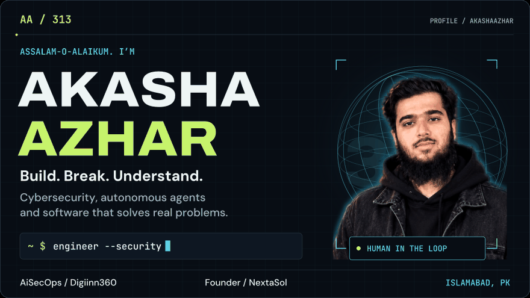
</picture>

<a href="https://akashaazhar.com">Portfolio</a> · <a href="https://www.linkedin.com/in/akashaazhar313/">LinkedIn</a> · <a href="https://nextasol.com">NextaSol</a> · <a href="mailto:nextasol.com@gmail.com">Email</a>

I work at the intersection of cybersecurity, AI agents and software engineering. I’m studying BS Cyber Security at STMU and building Nextrator at NextaSol.

<picture>
  <source media="(max-width: 600px)" srcset="./assets/313/section-builds-mobile.png">
  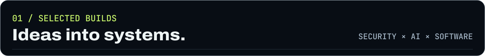
</picture>

<picture>
  <source media="(max-width: 600px)" srcset="./assets/313/nextrator-mobile.png">
  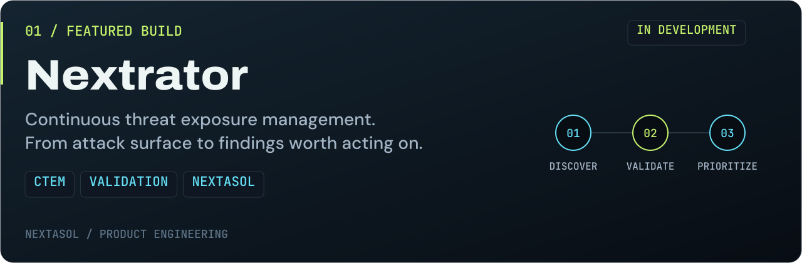
</picture>

<picture>
  <source media="(max-width: 600px)" srcset="./assets/313/projects-agents-mobile.png">
  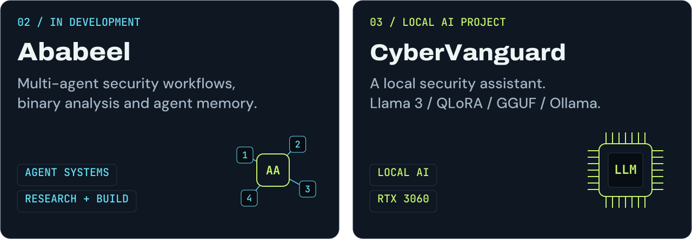
</picture>

<picture>
  <source media="(max-width: 600px)" srcset="./assets/313/projects-tools-mobile.png">
  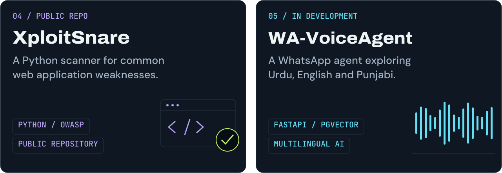
</picture>

[XploitSnare repository](https://github.com/AkashaAzhar/XploitSnare) · [Explore NextaSol](https://nextasol.com)

<picture>
  <source media="(max-width: 600px)" srcset="./assets/313/section-evidence-mobile.png">
  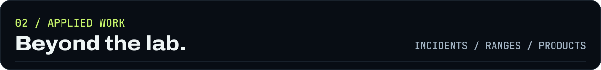
</picture>

<picture>
  <source media="(max-width: 600px)" srcset="./assets/313/evidence-mobile.png">
  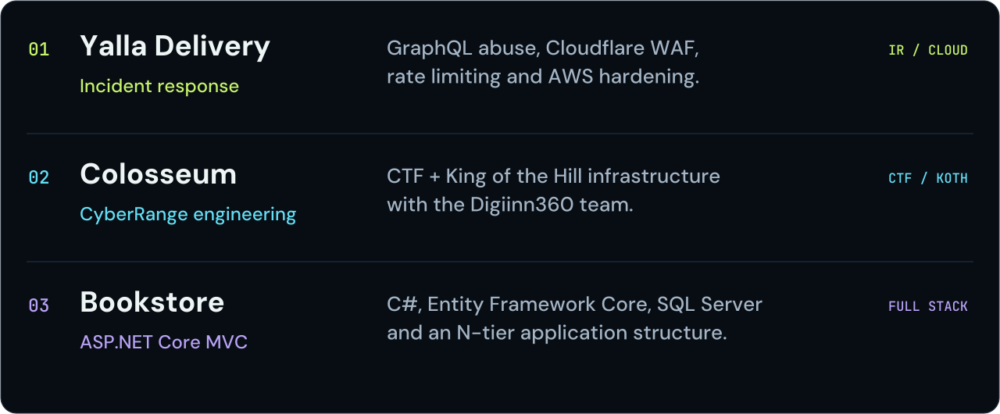
</picture>

**Yalla Delivery:** Helped mitigate GraphQL abuse with Cloudflare WAF, rate limits and AWS origin hardening. **Colosseum:** Worked with Digiinn360 on CTF and King of the Hill infrastructure. **Bookstore:** Built an N-tier application with ASP.NET Core MVC, Entity Framework Core and SQL Server.

**Research presentation** · Amaan Masood and I presented an approach to APT threat attribution using static analysis and clustering. [Presentation on LinkedIn](https://www.linkedin.com/posts/akashaazhar313_an-automated-approach-for-real-world-threat-activity-7391338435023806464-xUXM)

<picture>
  <source media="(max-width: 600px)" srcset="./assets/313/section-stack-mobile.png">
  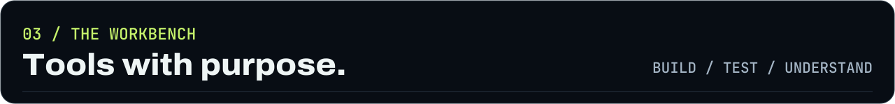
</picture>

<picture>
  <source media="(max-width: 600px)" srcset="./assets/313/stack-mobile.png">
  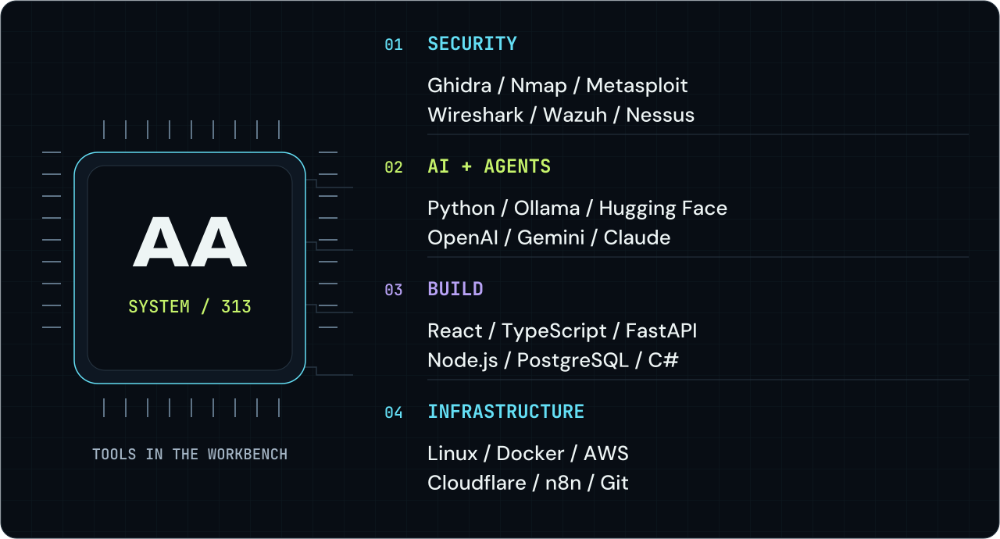
</picture>

<picture>
  <source media="(max-width: 600px)" srcset="./assets/313/identity-mobile.png">
  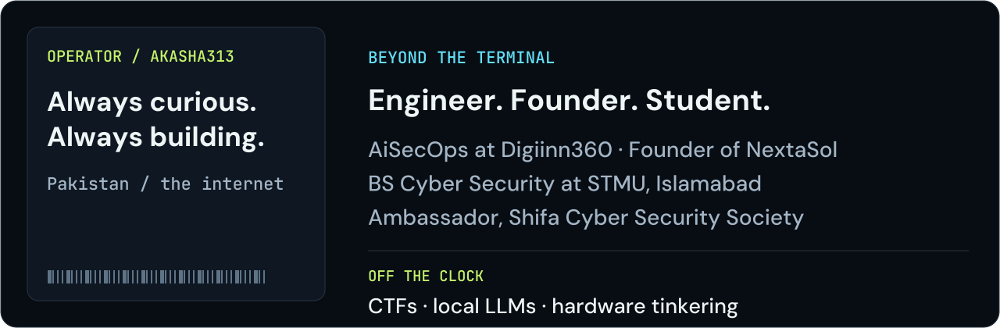
</picture>

<strong>More builds, client work and experiments</strong>

### Security, AI & Software Projects

| Project | Scope |
| :--- | :--- |
| **Autonomous SIEM** | Final year project on anomaly detection and alert triage using user and entity behavior analytics. |
| **Buz Fuz** | Professional work on an AI-assisted software security analysis platform. |
| **Local LLM Batch Document Engine** | Offline document analysis with Python, Ollama, PyMuPDF and SQLite. |
| **Internship Portal** | Task sequencing, submission reviews, email notifications and certificates. |
| **NextaLearn LMS** | React and FastAPI platform with PostgreSQL, role-based access, course progress and certificates. |
| **ASP.NET Core MVC Bookstore** | C#, Entity Framework Core and SQL Server in an N-tier application. |

### Agentic Engineering Toolkit

| Project / area | Scope |
| :--- | :--- |
| **AI Software Factory** | A phase-gated SDLC framework for AI coding agents: requirements, architecture decisions (ADRs), STRIDE threat modelling, progress handoff files and verification gates. |
| **Agent Skill Packages** | Reusable skill modules injected into autonomous agents: codebase forensic analysis, web code review, frontend UI upgrades, AI/agent stack selection, AI-embedded web project building, and an expert AI and data-engineering module. |

### NextaSol Products & Client Delivery

| Project / area | Scope |
| :--- | :--- |
| **NextaSol Product Suite** | NextaBMS (business management), NextaSec (WordPress security plugin), NextaForms (smart forms), and NextaPost AI (social post generation), plus an AI chat app at chat.akashaazhar.com. |
| **AI Voice & Calling Agent** | A calling-agent solution combining workflow orchestration, Whisper speech recognition, ElevenLabs voices and LLM reasoning. |
| **EV Ride-Hailing Platform** | Client work on a passenger, driver and guardian mobile app in Flutter with a separate admin web panel. |
| **Digital Alumni Platform** | Product coordination, bug triage and user-acceptance testing for an alumni association's mobile platform. |

### Business & Productivity Software

| Project / area | Scope |
| :--- | :--- |
| **C++ POS & Inventory** | Multi-user login, inventory, sales history, customer records, discounts, and credential management. |
| **Python Inventory Application** | Tkinter and SQLite work covering item management, search, and CSV import/export. |
| **React Invoice & Quotation System** | Dashboard, routing, CRUD operations, and a MySQL-backed invoicing and quotation workflow. |
| **ERP / CRM & Hostel Management** | Full-stack business systems, including ERP / CRM SaaS and hostel management. |
| **CodeIgniter Application Work** | PHP application maintenance, database migration, hosting compatibility, and management-system workflows. |
| **Web & E-Commerce Delivery** | WordPress and Elementor websites, Shopify and WooCommerce stores, responsive layouts, hosting, DNS, and ongoing store management. |
| **Frontend Utilities** | A persistent to-do app, an A4 resume with PDF export, a stopwatch, a weather app, and contact-form integrations using EmailJS. |
| **Self-Hosted Cloud** | Nextcloud setup and Linux server administration experiments. |

### AI, Security & Academic Work

| Project / area | Scope |
| :--- | :--- |
| **Packet Analysis Tool** | A Python / Scapy packet analyser with a CLI and a Tkinter GUI featuring protocol colour-coding and live filters. |
| **pfSense Firewall Lab** | A dual-interface pfSense lab (NAT WAN, host-only LAN), extended with a Kali client to explore firewall rules, Snort IDS / IPS and VPNs. |
| **Security Application Projects** | Java (Swing + MySQL) antivirus, a SHA-256 password manager, a Python/Metasploit penetration-testing framework, a malware-detection system, a steganography app, a Python forensics simulator, and an Android forensics tool. |
| **Computer-Vision Experiments** | Face-recognition attendance, age and gender detection, and webcam emotion detection. |
| **Voice-Assistant Experiments** | Earlier JARVIS / ABABIL assistant work using Python, speech recognition, and text-to-speech. |
| **Gemini API Chatbot** | A conversational interface built with HTML, CSS, JavaScript, and the Gemini API. |
| **CTF & Reverse Engineering** | Solving reverse-engineering challenges from decompiled C, including multi-step XOR / shift transformations. |

### Ideas & Prototypes Under Exploration

The following are concepts or previously discussed project directions; they are not presented as completed products.

- **Java Network Analysis Tool** - network-analysis project planning using IntelliJ IDEA and Ant.
- **Pico Wireless Security Analysis Tool** - a Raspberry Pi Pico concept using a keypad, LCD, and LED indicators for testing my own network.
- **Hardware Wallet** - an embedded security concept combining a Pico, ATECC608A secure element, buttons, and an LCD.
- **Unified Social Inbox / CRM** - exploring a shared workspace for Facebook, Instagram, WhatsApp, LinkedIn, and X conversations.
- **Pharma-AI** - a domain-specific AI application idea.
- **Video Downloader Interface** - frontend exploration for a download-management workflow.
- **Arduino Anti-Sleeping Glasses** - an early electronics project direction using an Arduino Nano.

<strong>Experience & community — leadership, teaching and practical work</strong>

| Role | Organization / contribution |
| :--- | :--- |
| **Founder** | **NextaSol**. Software, e-commerce, AI solutions, cybersecurity, cloud and IT consulting, branding and digital marketing. |
| **AiSecOps Engineer** | **DigiInn360**. Work across AI-assisted security operations and vulnerability assessment / penetration testing. |
| **CyberRange Team** | **Colosseum CyberRange**, CyberStrike CTF & King of the Hill, 2026, FAST-NUCES Islamabad. |
| **Ambassador** | **Shifa Cyber Security Society**, Shifa Tameer-e-Millat University. |
| **WordPress Developer & Store Manager** | **Softronix IT Services**. Website development and e-commerce store management during my studies. |
| **Cybersecurity Intern** | **Air University, Islamabad**. Early practical exposure to cybersecurity through a short internship. |
| **Digital Marketing Instructor** | Three months of teaching experience in digital marketing. |
| **Event Designer & Organizer** | **Huawei event at STMU (2024)**. Received a Certificate of Appreciation. |
| **Workshop facilitator** | Cybersecurity awareness and digital forensics workshop for medical and biotechnology students at STMU. |
| **SOC internship** | ITSolera. |

<strong>Education & certifications — the learning journey</strong>

| Qualification | Institution | Period |
| :--- | :--- | :--- |
| **BS Cyber Security** | Shifa Tameer-e-Millat University (STMU), Islamabad | 2023–present |
| **Diploma of Associate Engineer - Computer Information Technology** | KRL Institute of Technology, Kahuta | 2020-2023 · Completed; 77% overall, 82% in the final year |
| **Matriculation - Computer Science** | Pole Star Model High School | 2020 |

### Certifications & Professional Learning

| Credential / learning area | Provider |
| :--- | :--- |
| **CSCSO** | EU Cyber Academy |
| **Introduction to Critical Infrastructure Protection (ICIP)** | OPSWAT Academy |
| **Foundations of Cybersecurity** | Google |
| **Microsoft Office Specialist (MOS)** | Microsoft |
| **Advanced Web Application Development** | NAVTTC / Air University |
| **Dynamic User Interfaces for Websites; Responsive Web Design in Adobe XD** | Google Career Certificates |
| **Graphic Designing** | DigiSkills |
| **Certified Digital Media Marketing** | PNY Trainings |
| **E-Commerce Virtual Assistant** | PFTP |
| **Cloud Computing Essentials with AWS** | DevTown |
| **Introduction to Linux; Generative AI for Sales and Services Professionals** | LinkedIn Learning |
| **Google My Business - Local SEO & Local Business Marketing** | Skillshare |
| **Claude 101; Claude Code in Action; AI Fluency for Small Businesses** | Anthropic |
| **Create Your First Gemini Enterprise Application** | Google Cloud Skills Boost |

<strong>Open the full toolkit — platforms, frameworks & practical experience</strong>

Technologies I work with or have explored across projects, coursework, and research:

| Area | Tools & technologies |
| :--- | :--- |
| **Languages & Web Fundamentals** | Python, C, C#, C++, Java, JavaScript, TypeScript, PHP, Go, Rust (Tauri), Bash, PowerShell, SQL, x86 Assembly, HTML, CSS |
| **Frontend & Application Development** | React, Next.js, Vite, Tailwind CSS, shadcn/ui, Flowbite, TailAdmin, Zustand, Bootstrap, jQuery, Node.js, Express, NestJS, FastAPI, ASP.NET Core MVC, CodeIgniter, Flutter, Tauri 2, Streamlit, Tkinter, PyQt, Java Swing / JavaFX |
| **Databases & Backend Services** | PostgreSQL + pgvector, MySQL, SQL Server, MariaDB, SQLite, Redis, Supabase, MySQL Workbench, phpMyAdmin |
| **Offensive Security & Reverse Engineering** | VAPT, WAPT, Nmap, Nikto, WPScan, Metasploit, Ettercap, theHarvester, dnsrecon / dnsenum, Nessus, OWASP tooling, Ghidra, QEMU, FLOSS, binary analysis, fuzzing, CTEM |
| **Network & Defensive Security** | Wireshark, Scapy, pfSense, Snort, Wazuh, QRadar, Cisco Packet Tracer, TLS traffic analysis, SIEM architecture, threat hunting |
| **AI & Agent Systems** | Hermes, Cognee, Honcho, Nemo Claw, Ollama, llama.cpp, Hugging Face, Unsloth, LoRA / QLoRA / PEFT, GGUF, OpenAI API, Gemini / Vertex AI, AWS Bedrock, Claude Code CLI, ElevenLabs, Whisper, Tavily, OpenCV, DeepFace, PyMuPDF |
| **Automation** | n8n, log-pipeline automation, cyber ranges |
| **Systems, Cloud & Virtualization** | Linux, Ubuntu Server, Arch, Kali, WSL2, Hyprland, Windows 11 Pro, Google Cloud, Docker, Nginx, Apache, Cloudflare (DNS / Zero Trust), aaPanel, VPS hosting, Tailscale, VMware Workstation, VirtualBox, SSH, DNS, Nextcloud |
| **Secure Engineering Practice** | SSDLC, STRIDE / DREAD / PASTA threat modelling, OWASP secure coding, ADRs, static malware analysis (PE headers, strings) |
| **Development Workflow** | Git, GitHub, VS Code, IntelliJ IDEA, Visual Studio, XAMPP |
| **CMS & E-Commerce** | WordPress, Elementor, Shopify, WooCommerce |
| **Hardware & Embedded** | ESP32, Raspberry Pi Pico, Arduino, I2C, LCD1602 / HD44780 displays, keypads, sensors, servo control, digital and analog electronics |
| **Design & Growth** | Figma, Adobe XD, Illustrator, Photoshop, Canva, UI/UX design, SEO, Google Ads, Meta Ads, social media management |

<strong>Research directions & ongoing learning</strong>

- **Agent execution:** REPL-based execution harnesses, evaluator-optimizer loops, persistent memory, self-improving agents, and multi-agent coordination.
- **Agentic software engineering:** phase-gated SDLC for AI coding agents and skill injection into autonomous agents.
- **Autonomous security operations:** AI-assisted investigation, UEBA, alert prioritization, autonomous exposure management, and response workflows.
- **Local model engineering:** parameter-efficient fine-tuning (LoRA / QLoRA) and private, offline inference on consumer GPUs.
- **Critical infrastructure & hardware security:** ICS / SCADA protection, post-quantum System-on-Chip architectures, and embedded security design.
- **DevOps:** expanding my understanding of CI/CD, infrastructure as code, Ansible, Jenkins, Terraform, and GitHub Actions.

<picture>
  <source media="(max-width: 600px)" srcset="./assets/313/connect-mobile.png">
  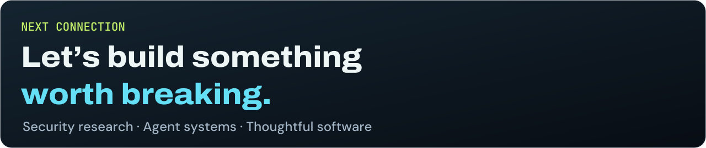
</picture>

<a href="https://akashaazhar.com">Portfolio</a> · <a href="https://www.linkedin.com/in/akashaazhar313/">LinkedIn</a> · <a href="https://nextasol.com">NextaSol</a> · <a href="mailto:nextasol.com@gmail.com">Email</a>

