

  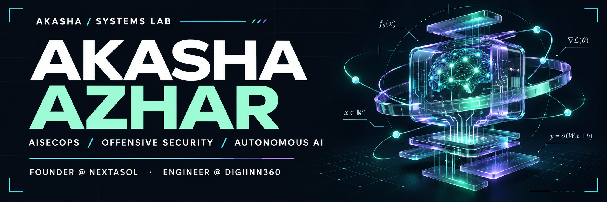

  
  
  
  

  <picture>
    <source media="(prefers-reduced-motion: reduce)" srcset="./assets/terminal-static.png" />
    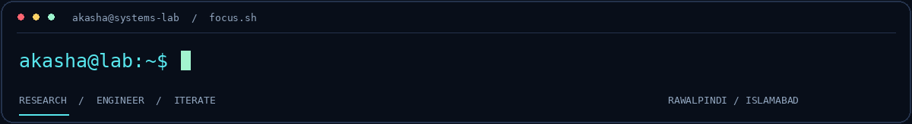
  </picture>

<strong>I build across the boundary between cybersecurity, autonomous AI and software engineering.</strong> 
From websites and business software to security tooling, agent systems and embedded experiments.

 

  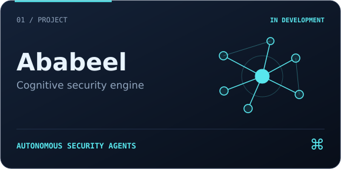
  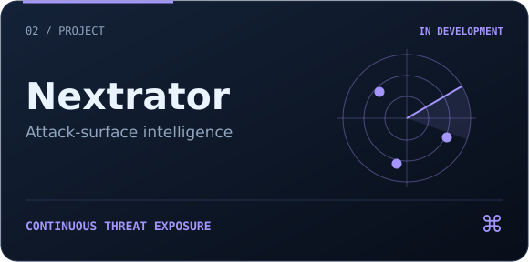

  <a href="https://github.com/AkashaAzhar/XploitSnare">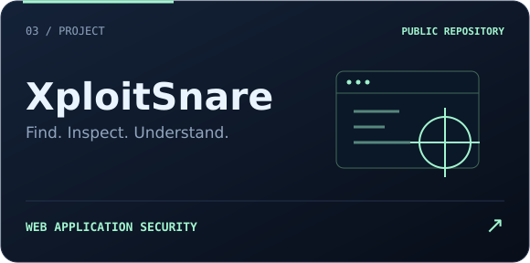</a>
  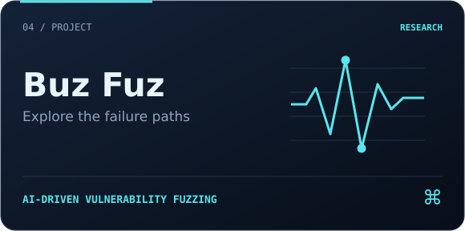

  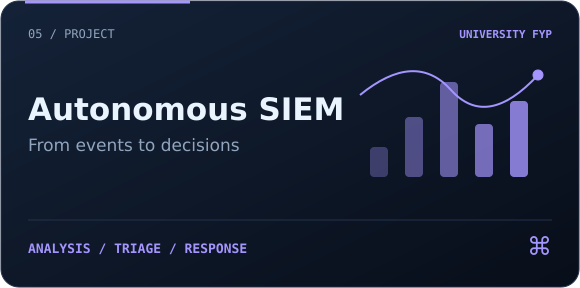
  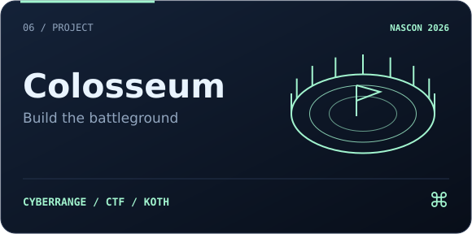

<strong>Explore the projects — descriptions, earlier builds & experiments</strong>

These projects span active development, research, academic work, and deployed event infrastructure.

| Project | Focus |
| :--- | :--- |
| **Ababeel** | Developing an autonomous, multi-agent cognitive cybersecurity engine for penetration-testing workflows, binary analysis, and vulnerability fuzzing. Its architecture explores agent memory, orchestration, and integration with reverse-engineering and emulation tools. |
| **Nextrator** | Developing a **Continuous Threat Exposure Management (CTEM)** platform under NextaSol to identify, validate, and prioritize organizational attack surfaces. |
| **Buz Fuz** | Work on AI-driven fuzzing and autonomous vulnerability analysis, with a focus on software flaws and memory-corruption bugs. |
| **Autonomous Next-Gen SIEM** | Final-year project work at STMU on AI-assisted log analysis, anomaly detection, alert triage, and incident-response workflows. |
| **[XploitSnare](https://github.com/AkashaAzhar/XploitSnare)** | A Python web-application security scanner developed as a fourth-semester project, targeting common vulnerability classes associated with the OWASP Top 10. AI-assisted analysis is an area for further development. |
| **Colosseum CyberRange** | Helped build, deploy, and co-host the infrastructure for **CyberStrike CTF and the King of the Hill hackathon at NASCON 2026, FAST-NUCES Islamabad**. |
| **Local LLM Batch Document Engine** | Work on an offline PDF analysis and summarization pipeline using Python, Ollama, PyMuPDF, and SQLite, with local GPU processing for sensitive document workflows. |
| **ESP32 Embedded Control Systems** | Microcontroller prototypes combining servo actuation, sensor interfacing, and I2C serial LCD displays. |

<!-- Source-draft metric retained for review: the Local LLM Batch Document Engine
was described as processing "17,000+ sensitive organizational records".
Confirm the count and whether it is a completed workload or a target before
adding that metric to the public description. -->

### Business & Productivity Software

| Project / area | Scope |
| :--- | :--- |
| **C++ POS & Inventory** | Multi-user login, inventory, sales history, customer records, discounts, and credential management. |
| **Python Inventory Application** | Tkinter and SQLite work covering item management, search, and CSV import/export. |
| **React Invoice System** | Dashboard, routing, CRUD operations, and a MySQL-backed invoicing workflow. |
| **CodeIgniter Application Work** | PHP application maintenance, database migration, hosting compatibility, and management-system workflows. |
| **Web & E-Commerce Delivery** | WordPress and Elementor websites, Shopify and WooCommerce stores, responsive layouts, hosting, DNS, and ongoing store management. |
| **Frontend Utilities** | A persistent to-do app, an A4 resume with PDF export, a stopwatch, a weather app, and contact-form integrations using EmailJS. |
| **Self-Hosted Cloud** | Nextcloud setup and Linux server administration experiments. |

### AI, Security & Academic Work

| Project / area | Scope |
| :--- | :--- |
| **Voice-Assistant Experiments** | Earlier JARVIS / ABABIL assistant work using Python, speech recognition, and text-to-speech. |
| **Gemini API Chatbot** | A conversational interface built with HTML, CSS, JavaScript, and the Gemini API. |
| **Security Application Projects** | Java antivirus, a PHP password manager, a Python/Metasploit penetration-testing framework, a Python forensics simulator, and an Android forensics tool. |
| **Computer-Vision Experiments** | Face recognition and emotion-detection project work. |

### Ideas & Prototypes Under Exploration

The following are concepts or previously discussed project directions; they are not presented as completed products.

- **Java Network Analysis Tool** - network-analysis project planning using IntelliJ IDEA and Ant.
- **Pico Wireless Security Analysis Tool** - a Raspberry Pi Pico concept using a keypad, LCD, and LED indicators for testing my own network.
- **Hardware Wallet** - an embedded security concept combining a Pico, ATECC608A secure element, buttons, and an LCD.
- **Unified Social Inbox / CRM** - exploring a shared workspace for Facebook, Instagram, WhatsApp, LinkedIn, and X conversations.
- **NextaBMS, Hostel Management & Pharma-AI** - business-management and domain-specific application ideas and project work.
- **Video Downloader Interface** - frontend exploration for a download-management workflow.
- **Arduino Anti-Sleeping Glasses** - an early electronics project direction using an Arduino Nano.

 

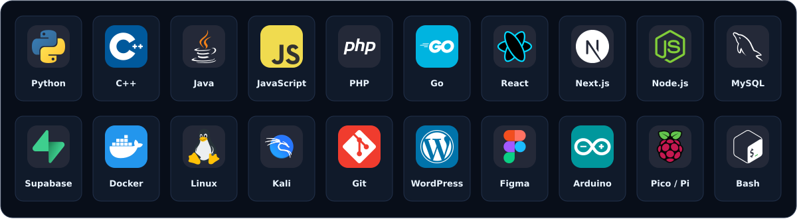

<strong>AI & agents</strong> · Hermes · Cognee · Honcho · Ollama · llama.cpp · Gemini API 
<strong>Security & reverse engineering</strong> · VAPT / WAPT · Ghidra · QEMU · Nmap · Metasploit

<strong>Open the full toolkit — platforms, frameworks & practical experience</strong>

Technologies I work with or have explored across projects, coursework, and research:

| Area | Tools & technologies |
| :--- | :--- |
| **Languages & Web Fundamentals** | Python, C, C++, Java, JavaScript, PHP, Go, Bash, PowerShell, SQL, x86 Assembly, HTML, CSS |
| **Frontend & Application Development** | React, Next.js, Tailwind CSS, Bootstrap, jQuery, Node.js, Express, CodeIgniter, Tkinter |
| **Databases & Backend Services** | MySQL, MariaDB, SQLite, Supabase, MySQL Workbench, phpMyAdmin |
| **Offensive Security & Reverse Engineering** | VAPT, WAPT, Nmap, WPScan, Metasploit, Ghidra, QEMU, binary analysis, fuzzing, CTEM |
| **AI & Agent Systems** | Hermes, Cognee, Honcho, Nemo Claw, Ollama, llama.cpp, Gemini API, AWS Bedrock, Claude Code CLI, PyMuPDF |
| **SecOps & Automation** | SIEM architecture, threat hunting, log-pipeline automation, cyber ranges, n8n |
| **Systems, Cloud & Virtualization** | Linux, Ubuntu, Kali, WSL2, Hyprland, Windows 11 Pro, Google Cloud, Docker, Tailscale, VMware Workstation, VirtualBox, SSH, DNS, Nextcloud |
| **Development Workflow** | Git, GitHub, VS Code, IntelliJ IDEA, Visual Studio, XAMPP |
| **CMS & E-Commerce** | WordPress, Elementor, Shopify, WooCommerce |
| **Hardware & Embedded** | ESP32, Raspberry Pi Pico, Arduino, I2C, LCD1602 / HD44780 displays, keypads, sensors, servo control, digital and analog electronics |
| **Design & Growth** | Figma, Adobe XD, Illustrator, Photoshop, Canva, UI/UX design, SEO, Google Ads, Meta Ads, social media management |

 

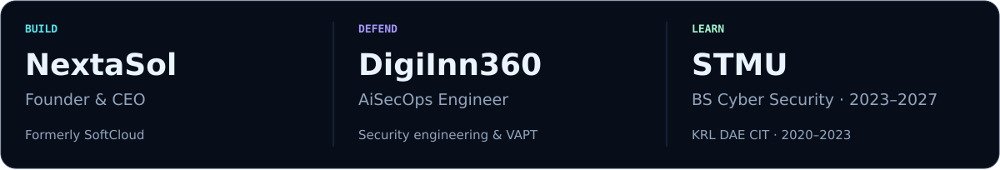

<strong>Experience & community — leadership, teaching and practical work</strong>

| Role | Organization / contribution |
| :--- | :--- |
| **Founder & CEO** | **NextaSol**, formerly **SoftCloud**. Leading an agency offering software and web development, e-commerce, AI solutions, cybersecurity, cloud and IT consultancy, branding, and digital marketing. |
| **AiSecOps Engineer & Senior VAPT/WAPT Specialist** | **DigiInn360**. Work across AI-assisted security operations and vulnerability assessment / penetration testing. |
| **Ambassador** | **Shifa Cyber Security Society**, Shifa Tameer-e-Millat University. |
| **WordPress Developer & Store Manager** | **Softronix IT Services**. Website development and e-commerce store management during my studies. |
| **Cybersecurity Intern** | **Air University, Islamabad**. Early practical exposure to cybersecurity through a short internship. |
| **Digital Marketing Instructor** | Three months of teaching experience in digital marketing. |
| **Event Designer & Organizer** | **Huawei event at STMU (2024)**. Received a Certificate of Appreciation. |

<strong>Education & certifications — the learning journey</strong>

| Qualification | Institution | Period |
| :--- | :--- | :--- |
| **BS Cyber Security** | Shifa Tameer-e-Millat University (STMU), Islamabad | 2023-2027 · In progress |
| **Diploma of Associate Engineer - Computer Information Technology** | KRL Institute of Technology, Kahuta | 2020-2023 · Completed; 77% overall, 82% in the final year |

### Certifications & Professional Learning

| Credential / learning area | Provider |
| :--- | :--- |
| **CSCSO** | EU Cyber Academy |
| **Foundations of Cybersecurity** | Google |
| **Microsoft Office Specialist (MOS)** | Microsoft |
| **Advanced Web Application Development** | NAVTTC / Air University |
| **Dynamic User Interfaces for Websites; Responsive Web Design in Adobe XD** | Google Career Certificates |
| **Graphic Designing** | DigiSkills |
| **Certified Digital Media Marketing** | PNY Trainings |
| **E-Commerce Virtual Assistant** | PFTP |
| **Cloud Computing Essentials with AWS** | DevTown |
| **Introduction to Linux; Generative AI for Sales and Services Professionals** | LinkedIn Learning |
| **Google My Business - Local SEO & Local Business Marketing** | Skillshare |
| **Claude 101; Claude Code in Action; AI Fluency for Small Businesses** | Anthropic |
| **Create Your First Gemini Enterprise Application** | Google Cloud Skills Boost |

<!-- Optional claim retained from the Gemini source draft:
"Verified researcher under Anthropic's Cybersecurity Verification Program."
Confirm the exact program status before displaying this publicly.
This is separate from Anthropic course-completion certificates. -->

 

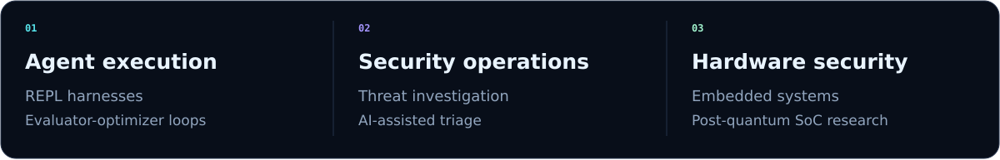

<strong>Research directions & ongoing learning</strong>

- **Agent execution:** REPL-based execution harnesses, evaluator-optimizer loops, persistent memory, and multi-agent coordination.
- **Autonomous security operations:** AI-assisted investigation, alert prioritization, and response workflows.
- **Hardware security:** post-quantum System-on-Chip architectures and embedded security design.
- **DevOps:** expanding my understanding of CI/CD, infrastructure as code, Ansible, Jenkins, Terraform, and GitHub Actions.

 

<a href="mailto:contact@nextasol.com">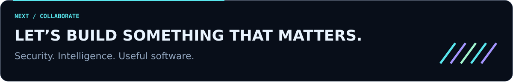</a>

Open to collaborations in offensive security, AI agents, CTEM and practical software products. 
<a href="mailto:contact@nextasol.com">contact@nextasol.com</a> · <a href="https://github.com/AkashaAzhar">@AkashaAzhar</a>

